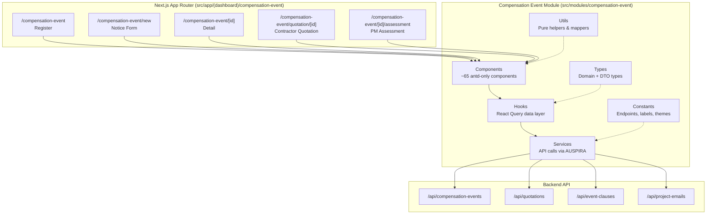
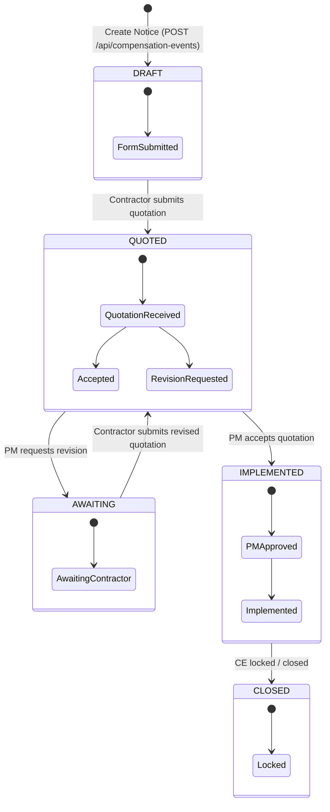
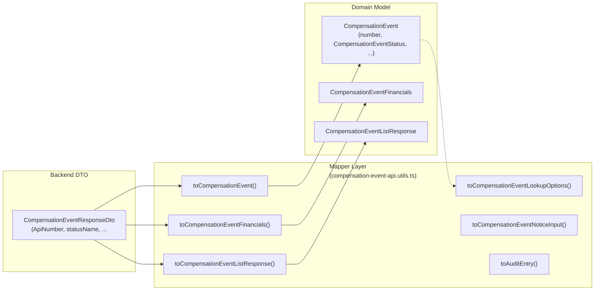
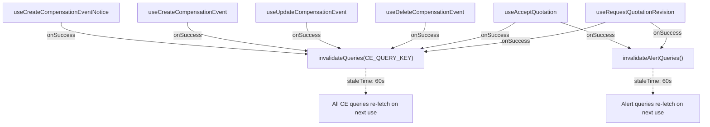

# Compensation Event — Feature Module

This module manages the full lifecycle of **Compensation Events (CE)** under
NEC4 Cl.62/63 — from initial contractor notice through quotation, PM assessment
and implementation. It follows the project's modular architecture: every file
lives inside this folder, and the barrel `index.ts` is the single public surface.

> **End-to-end flow:** for the full journey — where the CE workflow starts
> (sidebar, Early Warning "Link to CE" stage, dashboard signals), every screen
> and what it does, the lifecycle state machine, and the data path to the
> backend — see [end-to-end-flow.md](./end-to-end-flow.md).

---

## Table of Contents

1. [High-Level Architecture](#high-level-architecture)
2. [Module Structure](#module-structure)
3. [End-to-End Workflows](./workflows.md)
4. [State Machine](#state-machine)
5. [Data Flow Architecture](#data-flow-architecture)
6. [API Endpoints](#api-endpoints)
7. [Key Design Decisions](#key-design-decisions)
8. [Shared Components](#shared-components)

---

## High-Level Architecture



**Dependency direction is strict:**
```
Components → Hooks → Services → AUSPIRA (backend)
```
Components never call the service directly. Services are the only layer that
talks to the API.

---

## Module Structure

```
src/modules/compensation-event/
├── index.ts                          # Barrel — all public exports
├── components/                       # ~65 antd-only UI components
│   ├── compensation-event-list-page.tsx         # Register container
│   ├── compensation-event-table.tsx             # Register table
│   ├── compensation-event-notice-page.tsx       # Notice form container
│   ├── compensation-event-detail-page.tsx       # Detail container
│   ├── compensation-event-quotation-page.tsx    # Quotation container
│   ├── compensation-event-assessment-page.tsx   # Assessment container
│   ├── compensation-event-email-thread-tab.tsx  # Email thread tab
│   └── ...                                      # 50+ more components
├── hooks/                            # React Query hooks
│   ├── use-compensation-events.ts    # List, detail, CRUD mutations@@
│   ├── use-event-clauses.ts          # Clause lookup for notice form
│   ├── use-quotation.ts              # Accept & request revision
│   ├── use-quotations.ts             # Quotation list by CE
│   └── use-project-email-thread.ts   # Email thread per entity
├── services/                         # API service functions
│   ├── compensation-event.service.ts # CE CRUD + financial summary
│   ├── event-clause.service.ts       # Clause catalogue
│   ├── quotation.service.ts          # Accept / request revision
│   └── project-email.service.ts      # Entity conversations
├── types/                            # TypeScript types
│   ├── compensation-event.types.ts        # Domain model
│   ├── compensation-event-api.types.ts    # Backend DTOs
│   ├── compensation-event-assessment.types.ts
│   ├── compensation-event-quotation.types.ts
│   ├── compensation-event-notice.types.ts
│   ├── compensation-event-email.types.ts
│   ├── event-clause.types.ts
│   └── project-email-api.types.ts
├── utils/                            # Pure helpers
│   ├── compensation-event.utils.ts        # Formatting, filtering
│   ├── compensation-event-api.utils.ts    # DTO → domain mappers
│   ├── compensation-event-assessment.utils.ts
│   ├── compensation-event-quotation.utils.ts
│   ├── compensation-event-notice.utils.ts
│   ├── compensation-event-currency.utils.ts
│   ├── compensation-event-email.utils.ts
│   ├── event-clause.utils.ts
│   └── project-email.utils.ts
├── constants/                        # Module-owned config
│   ├── compensation-event.constants.ts       # Endpoints, states, labels
│   ├── compensation-event-notice.constants.ts
│   ├── compensation-event-assessment.constants.ts
│   ├── compensation-event-audit.constants.ts
│   ├── compensation-event-detail.constants.ts
│   ├── compensation-event-financials.constants.ts
│   ├── compensation-event-evidence.constants.ts
│   ├── compensation-event-quotation.constants.ts
│   └── *.theme.ts                          # Ant Design ConfigProvider tokens
└── mocks/                            # Fallback demo data
    ├── compensation-event.mock.ts
    └── compensation-event-quotation.mock.ts
```

---

## End-to-End Workflows

Screen-by-screen walkthroughs (sequence diagrams + key details) for the six
workflows — CE Register, Notice, Detail, Quotation, PM Assessment and Email
Thread — live in [workflows.md](./workflows.md). The full journey across the
app (entry points, lifecycle, state machine, data flow) is in
[end-to-end-flow.md](./end-to-end-flow.md).

---

## State Machine

The CE progresses through these register states:



**Legacy status mapping:**

| Legacy Status | Maps To |
|---------------|---------|
| `SUBMITTED` | `AWAITING` |
| `APPROVED` | `IMPLEMENTED` |
| `REJECTED` | `CLOSED` |
| `PAID` | `CLOSED` |

**Display tones:**

- **Compensation Event Type** — `GET /api/compensation-events/project/{projectId}/lookup`
  via `useGetCompensationEventLookupOptions`. Each option is labelled
  `"<reference> - <title>"` and holds the CE id. The create DTO has no field for a CE
  link, so the id itself is not sent: the payload's `Type` keeps the backend's
  `CONTRACTOR_NOTIFICATION` default (`resolveNoticeTypeValue`) and the chosen CE's label
  is preserved in `Notes` as `Related CE: …`, the same way role and issue date are.
  Give the DTO a real CE-link field and this should move onto it.
- **Relevant Contract Clause** — `GET /api/event-clauses/project/{projectId}` via
  `useGetEventClauseOptions`. Each option's value is the composite label
  `"<clauseNumber> - <title>"`, which `splitContractClause` splits back into
  `ClauseNumber` / `ClauseTitle` for the multipart create payload. No clauses
  configured on the project means an empty select — nothing is faked.
- **Lookup hooks** — `useGetCompensationEventsLookup` returns the raw
  `{ id, reference, title }` rows; `useGetCompensationEventLookupOptions` maps the
  same cache entry to Select options. Both share one query key, so a screen can take
  either shape without a second request.

---

## Data Flow Architecture

### API → Domain Mapping



The UI **never** consumes backend DTOs directly. Every API response passes through
a mapper in `compensation-event-api.utils.ts` before reaching components.

### Cache Invalidation



All mutations invalidate the same `COMPENSATION_EVENT_QUERY_KEY`, so any screen
that re-mounts (or does a `refetchOnWindowFocus`) gets fresh data.

---

## API Endpoints

### Compensation Events

| Method | Endpoint | Purpose | Loader |
|--------|----------|---------|--------|
| `GET` | `/api/compensation-events/project/:projectId` | List CEs (paged) | skipLoader |
| `GET` | `/api/compensation-events/project/:projectId/lookup` | Lightweight id/ref/title | skipLoader |
| `GET` | `/api/compensation-events/:id` | Full CE detail | skipLoader |
| `GET` | `/api/compensation-events/:id/financial` | Financial summary | skipLoader |
| `GET` | `/api/compensation-events/verify-reference` | Check reference availability | skipLoader |
| `POST` | `/api/compensation-events` | Create CE (multipart) | Loader |
| `PUT` | `/api/compensation-events/:id` | Update CE | Loader |
| `DELETE` | `/api/compensation-events/:id` | Delete CE | Loader |

### Quotations

| Method | Endpoint | Purpose | Loader |
|--------|----------|---------|--------|
| `GET` | `/api/quotations/compensation-event/:id` | List quotations for a CE | skipLoader |
| `POST` | `/api/quotations/accept` | Accept quotation (by projectAlertId) | Loader |
| `POST` | `/api/quotations/request-revision` | Request revised quotation | Loader |

### Supporting

| Method | Endpoint | Purpose | Loader |
|--------|----------|---------|--------|
| `GET` | `/api/event-clauses/project/:projectId` | Clause catalogue | skipLoader |
| `GET` | `/api/project-emails/:entityId/conversations` | Entity conversations | skipLoader |

---

## Key Design Decisions

### Why `skipLoader` on most queries?
The full-screen `GlobalLoader` overlay is reserved for primary page-level fetches
the user is explicitly waiting for. List, lookup, and background tab queries use
`skipLoader: true` to avoid blocking navigation.

### Why client-side state filtering?
The backend list endpoint has no `status` filter parameter yet. The register
fetches a growing window (`top: visibleCount`) and filters locally by
`resolveRegisterState()`. This will be replaced with a server-side filter when the
backend adds one.

### Why `projectAlertId` instead of CE id for quotation actions?
The backend keys accept/revision on the **project alert** the quotation arrived on,
not the CE itself. The quotation page reads `?alertId=` from the URL. Without it,
the accept/revision buttons report "unavailable" rather than sending a request the
backend would reject.

### Why multipart for notice creation?
Attachments ride along with the notice fields in a single `POST`. The axios
interceptor detects `FormData` and sets `Content-Type: multipart/form-data`
automatically.

### Why mock data fallback?
`USE_MOCK_COMPENSATION_EVENTS` gates mock usage. When enabled, the register
and detail screens fall back to `MOCK_COMPENSATION_EVENT` if the API errors or
returns empty. This keeps the UI navigable during development. Mock data is
only used when the real backend is unavailable.

### Why `keepPreviousData`?
When paging through the register, `keepPreviousData` from React Query prevents
the table from flashing empty while the next page loads.

### Why `contentEditable` for email editing?
The repo has no rich-text dependency. `document.execCommand` is deprecated but
universally supported. The `compensation-event-email-editor` component saves and
restores selection around every command. Replace when a real editor lands.

---

## Shared Components

These components are reused across multiple screens:

| Component | Used By |
|-----------|---------|
| `compensation-event-page-header` | Quotation, Quotation detail, Assessment |
| `compensation-event-clause-chip` | Register, Notice, Quotation, Quotation detail, Assessment, Detail |
| `compensation-event-notice-section-card` | Quotation, Assessment, Detail |
| `compensation-event-notice-clause-banner` | Notice, Quotation, Assessment |
| `compensation-event-notice-documents-communication` | Notice, Quotation, Assessment |
| `compensation-event-status-tag` | Register table, Detail banner |
| `compensation-event-state-badge` | Register table |
| `compensation-event-direction-chip` | Register table |
| `compensation-event-request-revision-modal` | Quotation (revision) |
| `compensation-event-label-value-row` | Detail summary |

---

*Generated with Codebuff 🤖*
