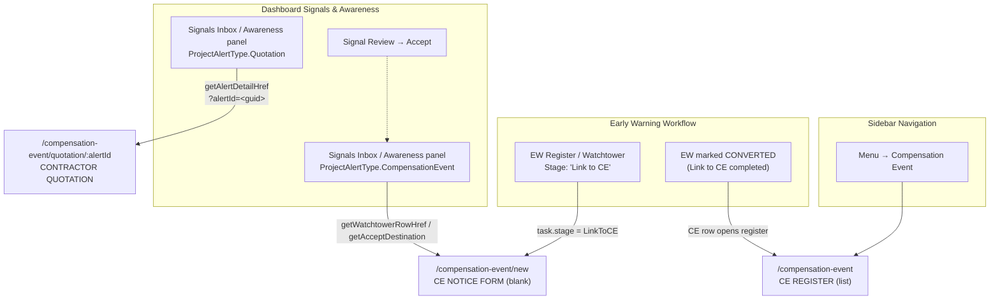
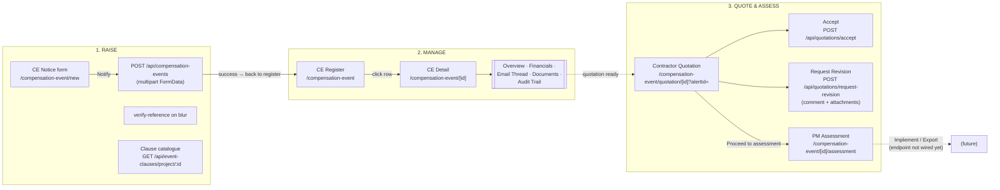
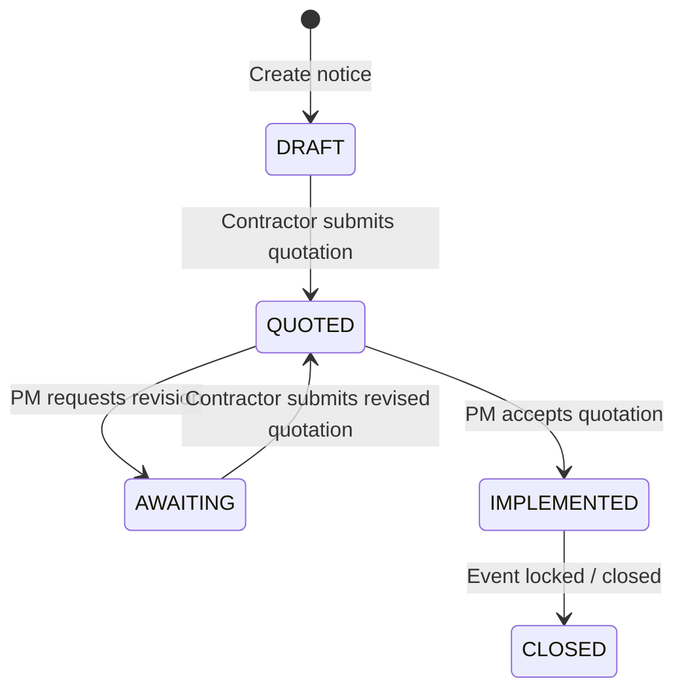

# Compensation Event — End-to-End Flow

This document maps the full **Compensation Event (CE)** journey in the Auspira
Frontend: where it starts, every screen it passes through, what each screen
does, and how data flows to the backend.

- **Domain:** NEC4 Cl.62 / 63 — a contractor raises a compensation event notice,
  quotes for it, the PM assesses and either accepts or asks for a revision, then
  the event is implemented and closed.
- **Codebase:** `src/modules/compensation-event/` (feature slice) + shared
  dashboard/alert screens that feed it.

---

## 1. Where It Starts (Entry Points)

The CE workflow has **three** places a user can land in it.



| # | Entry point | Where it goes | Why |
|---|-------------|---------------|-----|
| 1 | Sidebar menu → `/compensation-event` | CE Register | Manage all events of the project |
| 2 | EW stage **"Link to CE"** (Watchtower row / EW Register) | `/compensation-event/new` | Working the stage = raising the CE itself; once done the EW becomes `CONVERTED` |
| 3 | Dashboard signal **Quotation alert** | `/compensation-event/quotation/:alertId` | Review/act on a contractor quotation |
| 4 | Dashboard signal **CompensationEvent alert** | `/compensation-event/new` | Act on the alert by raising the CE notice |

All routes are protected by `src/middleware.ts` and breadcrumbed via
`src/constants/breadcrumb.constants.tsx`.

---

## 2. Full Lifecycle Diagram



---

## 3. What Each Screen Does

### 3.1 CE Register — `/compensation-event`
- Landing screen. Reads `?ew=` to pre-link a parent Early Warning reference.
- Lists CEs for the **selected project** (Zustand `selectedProjectId`), paged
  "Load More" (+10), client-side state filter pills, search.
- Columns: Ref & CE Reference · Parent EW · State · Quote Value · Time Impact ·
  Cl.62.3 Reply · Clauses. Badges colored per state; direction chip (IN/OUT).
- Recent Activity panel (audit phrases).
- **Data:** `useGetCompensationEvents` → `GET /api/compensation-events/project/:projectId`
  (`skipLoader: true`, `keepPreviousData`).

### 3.2 CE Notice — `/compensation-event/new`
- Create form: To/From party, Reference (verified on blur), Clause + description
  (from project clause catalogue), Type, additional clause refs, attachments.
- Progress % derived from filled fields; Time Bar = issued + 14 days (NEC4
  Cl.62.3 reply period).
- **Data:** `useCreateCompensationEventNotice` → `POST /api/compensation-events`
  (multipart). Success invalidates the CE query key and navigates to the register.

### 3.3 CE Detail — `/compensation-event/[id]`
Five tabs:
| Tab | Content | Data source |
|-----|---------|-------------|
| Overview | Key summary metrics + event summary | `GET /api/compensation-events/:id` |
| Financials | Metrics + quotation summary | `GET /api/compensation-events/:id/financial` (404 silently swallowed) |
| Email Thread | All conversations, flattened | `GET /api/project-emails/:entityId/conversations` + per-conversation thread |
| Documents | Evidence pack (presentational) | `event.evidence` (awaiting backend) |
| Audit Trail | Paginated activity log | `GET /api/audit-logs?entityId=` |

### 3.4 Contractor Quotation — `/compensation-event/quotation/[id]?alertId=`
- Renders the latest quotation version: lines grouped by category
  (people/equipment/fee/other), members, risk allowance, programme impact.
- Totals derived from line items (`getQuotationTotal` + risk allowance).
- **Accept** → Popconfirm ("not reversible") → `POST /api/quotations/accept`
  keyed on `projectAlertId` from `?alertId=`.
- **Request Revised Quotation** → comment + document upload modal → keyword-confirm dialog →
  `POST /api/quotations/request-revision` (multipart: `description` carries the comment,
  `attachments` carries the staged files, `subject` a fixed line — the modal has no field
  for it and the endpoint takes no recipient list).
- Both mutations invalidate CE + project-alert query keys.

### 3.5 PM Assessment — `/compensation-event/[id]/assessment`
- Quotation lines become **editable cells** (pencil toggle); editing a member
  amount auto-reprices group/grand totals.
- Late-EW (63.7) warning banner, assessed days, comment card.
- Implement / Export buttons present but **no endpoint wired yet**.

---

## 4. State Machine



Legacy statuses fold into the register vocabulary:

| Legacy | Register state | Tone |
|--------|----------------|------|
| `SUBMITTED` | `AWAITING` | warning |
| `APPROVED` | `IMPLEMENTED` | success |
| `REJECTED` | `CLOSED` | neutral |
| `PAID` | `CLOSED` | neutral |

---

## 5. Data Flow

Strict layering, one direction:

```
UI Components → Hooks (React Query) → Services → AUSPIRA → Axios → Backend
```

- **React Query:** query keys `['compensation-event']`, `['quotation']`,
  `['event-clause']`, `['project-email']`; staleTime 60 s, gcTime 5 min.
- **Mappers:** every DTO passes through `utils/compensation-event-api.utils.ts`
  (`toCompensationEvent`, `toCompensationEventFinancials`, …) — UI never
  touches DTOs.
- **`skipLoader: true`** on all list/lookup queries; the full-screen loader is
  used only for the notice create POST.
- **Mocks:** `mocks/compensation-event.mock.ts` (register/detail) and
  `mocks/compensation-event-quotation.mock.ts` (quotation) fall back only when
  the API errors or returns empty.
- **Auth:** JWT refresh happens transparently in the axios layer.

### Key endpoints

| Method | Endpoint | Used by |
|--------|----------|---------|
| `GET` | `/api/compensation-events/project/:projectId` | Register |
| `GET` | `/api/compensation-events/:id` | Detail |
| `GET` | `/api/compensation-events/:id/financial` | Financials tab |
| `GET` | `/api/compensation-events/verify-reference` | Notice form (on blur) |
| `POST` | `/api/compensation-events` | Notice create (multipart) |
| `GET` | `/api/quotations/compensation-event/:id` | Quotation screen |
| `POST` | `/api/quotations/accept` | Accept quotation |
| `POST` | `/api/quotations/request-revision` | Request revision |
| `GET` | `/api/event-clauses/project/:projectId` | Notice clause options |
| `GET` | `/api/project-emails/:entityId/conversations` | Email thread tab |

---

## 6. Known Gaps

- PM Assessment **Implement/Export** have no backend endpoint yet.
- Documents/evidence tab is presentational (backend fields empty).
- Quotation screen renders mock data; accept/revision are keyed on the project
  alert (`?alertId=`), not the CE id.
- Register state filtering is client-side — the list endpoint has no status
  filter yet.
