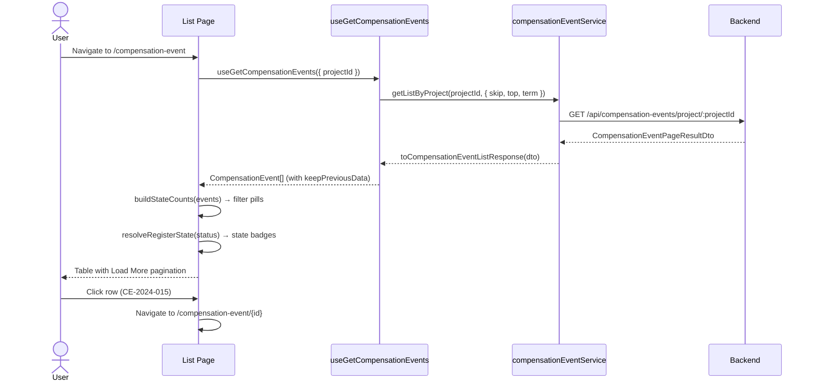
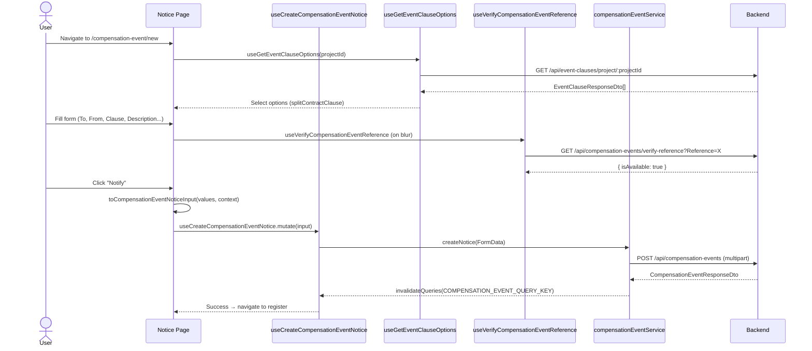
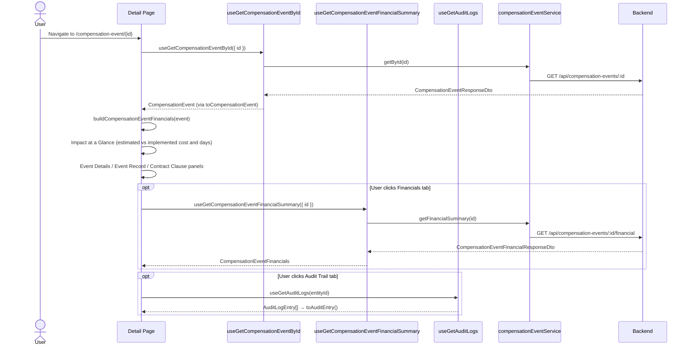
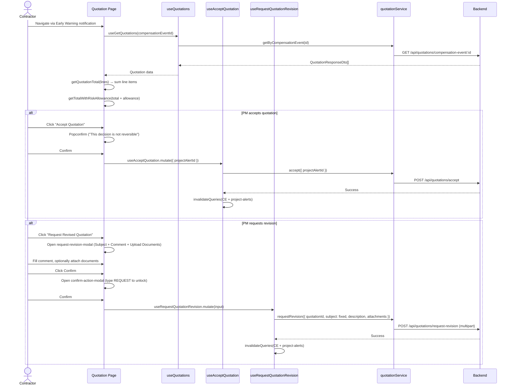
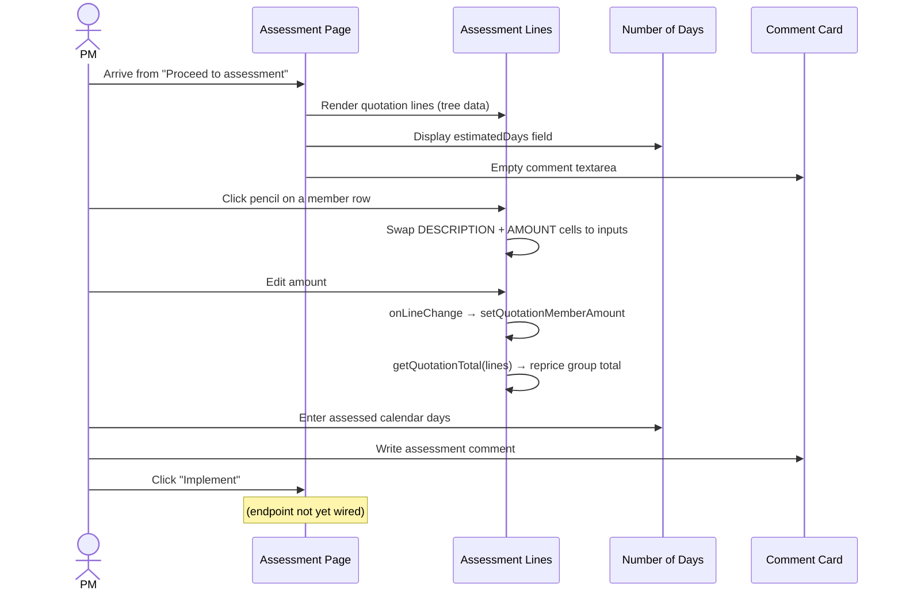
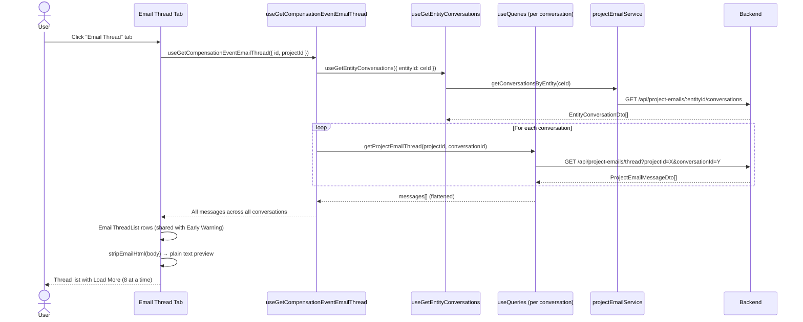

# Compensation Event — Workflows

Screen-by-screen walkthrough of the six CE workflows, including sequence
diagrams and key details. For the full journey (entry points, lifecycle, state
machine, data flow) see [end-to-end-flow.md](./end-to-end-flow.md). For module
architecture and design decisions see [README.md](./README.md).

---

## 1. CE Register (List & Browse)

The register is the landing screen for the entire CE workflow.

**Route:** `/compensation-event`
**Container:** `compensation-event-list-page` → **Presentational:** `compensation-event-table`

**Key details:**
- Uses `skipLoader: true` — the full-screen overlay never blocks list navigation.
- `keepPreviousData` prevents flash-of-empty-table when paging.
- State filtering is **client-side** — the server has no status filter endpoint yet.
- `Load More` grows `visibleCount` by 10 instead of traditional pagination.
- Legacy API statuses (`SUBMITTED`, `APPROVED`, etc.) are folded into the
  register vocabulary via `resolveRegisterState()`.
- Mock data (`MOCK_COMPENSATION_EVENT`) falls back only when the API errors or
  returns empty.

---

## 2. CE Notice (Create)

The notice form creates a new CE, optionally linked to an Early Warning.

**Route:** `/compensation-event/new`
**Container:** `compensation-event-notice-page`

**Key details:**
- Form data is sent as **multipart FormData** (attachments ride along).
- The right rail (progress, time bar, documents) is hidden on `/new` since there's
  no saved CE to attach them to — the form runs full width.
- `Progress %` is derived from filled fields, not hardcoded.
- `Time Bar` = `dateIssued + 14 days` (NEC4 Cl.62.3 reply period).
- Reference number is verified against the backend before submit.
- Clause options come from the project's configured clause catalogue.
- Impact & Requirements fields default to `0` since the notice screen doesn't
  collect them.

---

## 3. CE Detail (Overview)

The detail page shows the full picture of a CE after creation.

**Route:** `/compensation-event/[id]`
**Container:** `compensation-event-detail-page` → Tabs: Overview, Financials, Email Thread, Documents, Audit Trail

**Tab architecture:**

| Tab | Component | Data Source |
|-----|-----------|-------------|
| Overview | `compensation-event-overview-tab` | `useGetCompensationEventById` |
| Financials | `compensation-event-financials-tab` | `useGetCompensationEventFinancialSummary` + client-derived figures |
| Email Thread | `compensation-event-email-thread-tab` | `useGetCompensationEventEmailThread` |
| Documents | `compensation-event-evidence-pack` | `event.evidence` (empty — awaiting backend) |
| Audit Trail | `compensation-event-audit-trail-tab` | `useGetAuditLogs` (shared infra) |

---

## 4. Contractor Quotation

The contractor submits a quotation in response to the CE notice.

**Route:** `/compensation-event/quotation/[id]?alertId=<guid>`
**Container:** `compensation-event-quotation-page`

**Key details:**
- Every total is **derived from line items** — `getQuotationTotal` sums members;
  `getTotalWithRiskAllowance` adds the allowance.
- Accept is keyed on `projectAlertId` (from `?alertId=`), **not** the CE id.
  Without it, the button reports "unavailable" instead of sending a bad request.
- "Proceed to assessment" is a navigation action (no API call).
- The compose email modal is reusable (props-driven) and validates recipients
  before send.
- Quotation data currently uses mock data (`CONTRACTOR_QUOTATION_MOCK`).

---

## 5. PM Assessment

The project manager reviews the quotation and records their assessment.

**Route:** `/compensation-event/[id]/assessment`
**Container:** `compensation-event-assessment-page`

**Key details:**
- The assessment table reuses the quotation table structure with **editable cells**
  (pencil toggle on each member row).
- Editing a member amount **auto-recalculates** the group total and grand total.
- Group rows are read-only — their amount is the sum of members.
- The `relatedTarget` blur handler prevents accidental commits when tabbing
  between the DESCRIPTION and AMOUNT inputs on the same row.
- "Implement" button exists but the endpoint is not wired yet.
- "Export" button exists but the endpoint is not wired yet.
- The 63.7 late-EW warning banner appears when applicable.

---

## 6. Email Thread

Email communication is tracked per CE across all its conversations.

**Route:** Visible as a tab on the Detail page (`/compensation-event/[id]`)
**Tab:** `compensation-event-email-thread-tab` → `compensation-event-email-thread`

**Key details:**
- A CE can have **multiple conversations** — the tab shows all messages across all
  of them, fetched in parallel via `useQueries`.
- Email HTML is stripped to plain text via `stripEmailHtml()`.
- Rows render through the shared `EmailThreadList` component (`src/components/shared/`),
  so CE correspondence reads exactly like the Early Warning thread list — same avatar
  tinting, direction badges and timestamp format.
- "View All" opens with client-side "Load More" pagination (8 per page).
- Currently returns empty state — `CompensationEventResponseDto` has no
  thread/attachment fields yet. Wired and waiting for the backend.

---
